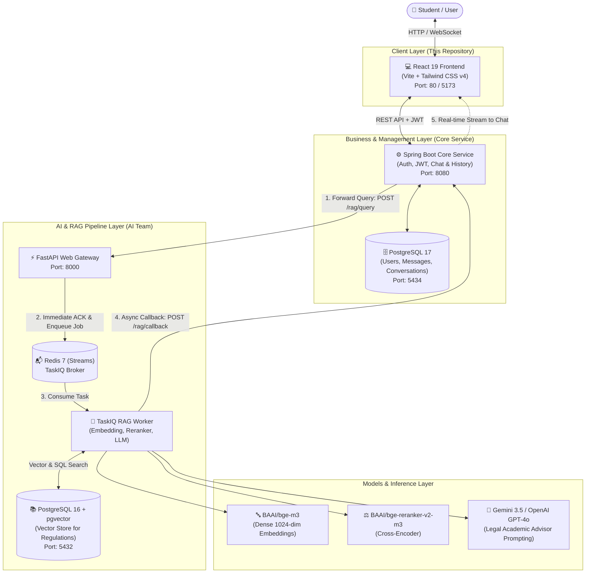

# 🎓 University Assistant (Frontend & System Documentation)

[](./frontend)
[](https://github.com/usc-ac-ir/university-assistant)
[](https://github.com/usc-ac-ir/university-assistant)
[](https://github.com/pgvector/pgvector)
[](https://redis.io/)
[](./docker-compose.yml)

> An enterprise-grade, multi-service **AI University Assistant** developed for the **University of Science and Culture (USC)**. Delivers intelligent, cited, and real-time answers to students, professors, and staff regarding educational bylaws, course schedules, academic calendars, and administrative procedures using an advanced RAG (Retrieval-Augmented Generation) pipeline.

---

## 📑 Table of Contents

1. [Overview](#-overview)
2. [System Architecture](#-system-architecture)
3. [Frontend Application Features](#-frontend-application-features)
4. [RAG Pipeline Specifications](#-rag-pipeline-specifications)
5. [Benchmarks & Evaluation](#-benchmarks--evaluation)
6. [Prerequisites](#-prerequisites)
7. [Running with Docker](#-running-with-docker)
8. [Local Development (Without Docker)](#-local-development-without-docker)
9. [Environment Variables Reference](#-environment-variables-reference)
10. [API & Webhook Contracts](#-api--webhook-contracts)
11. [Repository Structure](#-repository-structure)
12. [Contributors](#-contributors)

---

## 🌟 Overview

The **University Assistant** is an asynchronous microservices system designed to bridge students with university regulations and data through an intelligent conversational interface.

Key architectural capabilities:
- **Intelligent Query Routing:** Separates structured database inquiries (e.g., class schedules, instructor names) from complex unstructured text inquiries (e.g., probation rules, credit transfers, thesis policies).
- **Hybrid & Small-to-Big Retrieval:** High-precision semantic search over compact chunks, automatically expanded to the parent document context to preserve regulatory integrity.
- **Cross-Encoder Reranking:** Filters and re-ranks retrieved document passages to eliminate LLM hallucinations and enforce regulatory compliance.
- **Resilient Async Message Pipeline:** Immediate acknowledgment on API requests, background job execution via TaskIQ & Redis Streams, and reliable webhook callbacks with exponential backoff.

---

## 🏛 System Architecture



---

## 💻 Frontend Application Features

The frontend in [`frontend/`](./frontend) contains the complete UI application for students:

- **Framework & Styling:** Built with **React 19**, **Vite 8**, and **Tailwind CSS v4**.
- **State Management & Contexts:**
  - `AuthContext`: Manages student authentication, JWT tokens, and session persistence.
  - `ChatContext`: Handles real-time conversation loading, optimistic messages, active chat switching, and error recovery.
- **Real-Time WebSockets:** `websocket.js` enables instant bidirectional messaging with the Core Service.
- **REST API Integration:** `services/api.js` connects to backend authentication and chat history endpoints with automated auth headers.
- **Responsive UI:** Dark-mode Glassmorphism design, mobile-friendly collapsible sidebar, chat list management, and toast notifications (`react-hot-toast`).
- **Production-Ready Dockerization:** Multi-stage build with Nginx reverse proxying for WebSocket (`/ws`) and API routes, with SPA fallback routing.

---

## 🔍 RAG Pipeline Specifications

| Pipeline Stage | Technology / Model | Function |
|---|---|---|
| **Query Router** | LLM / Rule Classifier | Classifies questions into structured SQL (classes, times) vs. unstructured regulatory text |
| **Embedding Engine** | `BAAI/bge-m3` (1024 dimensions) | Multi-lingual semantic vector representation |
| **Vector Database** | `PostgreSQL 16` + `pgvector` | Dense vector indexing and similarity search using cosine distance |
| **Text Expansion** | Small-to-Big Parent Document | Retains small 200-word granular chunks for search, expands to parent articles for context |
| **Reranker** | `BAAI/bge-reranker-v2-m3` | Cross-Encoder precision scoring (Score Threshold: `0.20`) |
| **LLM Generator** | `Gemini 3.5 Flash Lite` / `GPT-4o-mini` | Formulates legal, citation-backed answers referencing specific article numbers |
| **Callback Broker** | `TaskIQ` + `Redis Streams` | Guarantees at-least-once answer delivery to Core Service with retry backoff |

---

## 📊 Benchmarks & Evaluation

Based on comprehensive stress-test benchmarks on university regulations (detailed in `BENCHMARK.md`):

| Evaluation Metric | Measured Result |
|---|---|
| **Stress Test Questions** | 9 multi-faceted regulatory scenarios |
| **Target Bylaw Citation Rate** | **88.9% (8 out of 9 successful)** |
| **End-to-End Pipeline Latency** | **1.26 seconds** (Average) |
| **Reranker Impact (Promoted to Rank 1)** | **7 out of 9 queries** promoted from outside the top 10 raw vector hits |

> [!NOTE]
> The cross-encoder reranker (`bge-reranker-v2-m3`) eliminated false positives when distinguishing between Undergraduate, Master's, and Doctoral rules, successfully promoting the target regulatory clauses to Rank 1.

---

## ⚙️ Prerequisites

- **Docker:** [Docker Desktop](https://www.docker.com/products/docker-desktop/) with **WSL 2** backend enabled on Windows.
- **For Bare-Metal Local Development (without Docker):**
  - **Node.js:** `v20.x` or later & `npm`
  - **Java JDK:** `21` and Maven (for Core Service)
  - **Python:** `3.11` (for AI Service)

---

## 🚀 Running with Docker

### Run the Frontend Container

Build and start the containerized UI using Docker Compose:

```bash
docker compose up -d --build
```

- **URL:** Open **[http://localhost](http://localhost)** in your browser.
- **Stop:** Run `docker compose down`.

---

## 💻 Local Development (Without Docker)

To run the frontend directly with Vite hot module replacement:

1. Navigate to the frontend directory:
   ```bash
   cd frontend
   ```
2. Install dependencies:
   ```bash
   npm install
   ```
3. Create your local environment configuration:
   ```bash
   cp .env.example .env
   ```
   *(Ensure `VITE_API_URL` and `VITE_WS_URL` point to your backend service)*
4. Start the Vite dev server:
   ```bash
   npm run dev
   ```
5. Open [http://localhost:5173](http://localhost:5173).

---

## 🔐 Environment Variables Reference

### Frontend Configuration (`frontend/.env`)

| Variable | Default Value | Description |
|---|---|---|
| `VITE_API_URL` | `http://localhost:8080` | Base URL for Core Service REST API |
| `VITE_WS_URL` | `ws://localhost:8080/ws` | WebSocket endpoint URL for live chat streaming |

---

## 📡 API & Webhook Contracts

### 1. Submit Query (`Core Service -> RAG Service`)
```http
POST /rag/query
Authorization: Bearer <RAG_SERVICE_TOKEN>
Content-Type: application/json

{
  "conversationId": "550e8400-e29b-41d4-a716-446655440000",
  "question": "What are the requirements for emergency course drop this semester?"
}
```
**Immediate Response (Async ACK):**
```json
{
  "status": "OK"
}
```

### 2. Callback Webhook (`RAG Service -> Core Service`)
```http
POST /rag/callback
Authorization: Bearer <RAG_CALLBACK_TOKEN>
Content-Type: application/json

{
  "conversationId": "550e8400-e29b-41d4-a716-446655440000",
  "answer": "According to Article 18 of the Academic Regulations, a student may drop one theoretical course with the approval of the academic department up to 5 weeks prior to the end of the semester, provided the remaining credits do not fall below the legal minimum.",
  "sources": [
    {
      "source": "Undergraduate Academic Bylaws",
      "page": 12,
      "score": 0.94
    }
  ]
}
```

---

## 📁 Repository Structure

```text
RAG-UI/
├── frontend/                # 💻 Frontend React Application
│   ├── src/
│   │   ├── assets/          # Logos and static media
│   │   ├── components/      # UI components (ChatInput, Header, Sidebar, etc.)
│   │   ├── context/         # AuthContext and ChatContext state managers
│   │   ├── pages/           # ChatPage, LoginPage, RegisterPage
│   │   ├── services/        # api.js and websocket.js network clients
│   │   ├── App.jsx          # Route definitions and layout
│   │   └── main.jsx         # Application entrypoint
│   ├── .dockerignore        # Docker build context exclusions
│   ├── .env.example         # Environment variable template
│   ├── Dockerfile           # Multi-stage production Nginx container
│   ├── nginx.conf           # Reverse proxy & SPA routing configuration
│   └── package.json
│
├── docker-compose.yml       # 🚀 Single-command deployment for the UI
├── .gitattributes
├── .gitignore
└── README.md                # 📖 Modern comprehensive English documentation
```

---

## 👥 Contributors

The **University Assistant** is developed and maintained by the University of Science and Culture (USC) development team:
- **Core Engineering:** Core backend architecture, authentication, database persistence, and WebSocket real-time delivery.
- **AI & ML Engineering:** RAG pipeline architecture, dense vector embeddings, cross-encoder reranking, and TaskIQ distributed queuing.
- **Frontend Engineering:** Modern user experience, conversational components, dark mode UI, and client state management.

---

<p align="center">
  Built with ❤️ for the students, faculty, and staff of the University of Science and Culture
</p>
