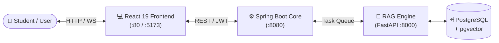

# 🎓 University Assistant

> A modern, conversational AI assistant for the **University of Science and Culture (USC)**. Powered by a high-precision RAG pipeline delivering cited, real-time answers for academic regulations, course schedules, and university procedures.

<p align="left">
  
  
  
  
  
  
  
</p>

---

## 🏛 Architecture Overview



---

## ✨ Key Features

- **Intuitive Interface:** Responsive dark-mode glassmorphic design, smooth message transitions, and active chat history.
- **Real-Time Streaming:** Live chat interaction powered by WebSocket connections and optimistic UI updates.
- **Smart Query Routing:** Intelligently directs inquiries between structured schedule data (SQL) and unstructured academic bylaws.
- **Precision RAG Pipeline:** Small-to-big parent document expansion paired with cross-encoder reranking (`bge-reranker-v2-m3`) for high-fidelity citations.
- **Async Resilience:** Non-blocking job processing via TaskIQ and Redis Streams with guaranteed webhook callback delivery.

---

## 🚀 Quickstart

### Option 1: Docker (Recommended)

Run the containerized application with a single command:

```bash
docker compose up -d --build
```

Access the UI at **[http://localhost](http://localhost)**.

---

### Option 2: Local Development

Run the frontend locally with Vite hot module replacement:

```bash
# 1. Navigate to the frontend directory
cd frontend

# 2. Install dependencies
npm install

# 3. Configure environment
cp .env.example .env

# 4. Start the development server
npm run dev
```

Access the app at **[http://localhost:5173](http://localhost:5173)**.

---

## ⚙️ Configuration

Set your environment variables in `frontend/.env`:

| Variable | Default Value | Description |
|---|---|---|
| `VITE_API_URL` | `http://localhost:8080` | Core Service backend REST API URL |
| `VITE_WS_URL` | `ws://localhost:8080/ws` | WebSocket endpoint for real-time messaging |

---

## 🛠 Tech Stack

| Layer | Technologies |
|---|---|
| **Frontend** | React 19, Vite 8, Tailwind CSS v4, React Router 8, React Hot Toast |
| **Core Service** | Spring Boot 3, Java 21, PostgreSQL 17, Spring Security (JWT), WebSockets |
| **AI & RAG** | Python 3.11, FastAPI, TaskIQ, Redis Streams, LlamaIndex, SQLAlchemy |
| **Models** | `BAAI/bge-m3` (Embeddings), `BAAI/bge-reranker-v2-m3` (Reranker), Gemini / GPT-4o |
| **Infrastructure** | Docker, Nginx, PostgreSQL (`pgvector`), Redis 7 |

---

## 📁 Repository Structure

```text
RAG-UI/
├── frontend/                # React 19 single-page application
│   ├── src/                 # Components, contexts, pages, and API clients
│   ├── Dockerfile           # Multi-stage production Nginx container
│   ├── nginx.conf           # SPA routing & WebSocket reverse proxy
│   └── package.json
├── docker-compose.yml       # Production deployment configuration
└── README.md                # Project documentation
```

---

<p align="center">
  Built with ❤️ for the students and faculty of the University of Science and Culture
</p>
